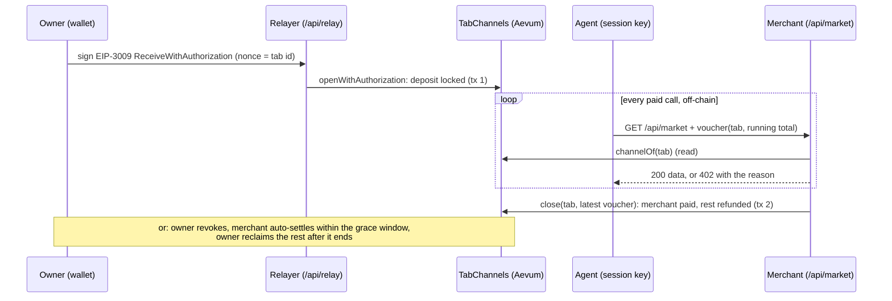

# Tab

Pay-per-call tabs for AI agents on QDay Aevum testnet.

You lock some tUSD8 in a tab and give your agent a session key. The agent pays for each API call with a signed voucher, off-chain. The merchant redeems the latest voucher when it wants its money. 500 paid calls cost two transactions: one to open the tab, one to close it.

The contract enforces the limits, so a compromised or prompt-injected agent can't go past them:

| Control | How |
|---|---|
| Spend cap | The deposit. Vouchers above it pay out the deposit and nothing more. |
| Session expiry | `closesAt`. After it, the merchant can't redeem and you reclaim the rest. |
| Least privilege | The session key signs vouchers for one tab, one merchant. It holds no funds and no gas. |
| Kill switch | `revoke` ends the tab 15 minutes later. The merchant stops serving at once and gets that window to redeem calls it already served. |
| Audit trail | `Opened`, `Settled`, `Revoked`, `Closed` events, shown per tab with explorer links. |

Built for [Aevum Builder Challenge #1](https://dorahacks.io/hackathon/qday/detail). Based on [Aevum Starter Kit](https://github.com/qday-io/aevum-starter-kit) (MIT, PQA Labs).

## Deployments (Aevum testnet, chain 44005)

| | Address |
|---|---|
| TabChannels | [`0xB43717cf69b03BBfBbbdf47eC3c830aBd20E9aC0`](https://explorer-test.qday.info/address/0xB43717cf69b03BBfBbbdf47eC3c830aBd20E9aC0) (block 3988684) |
| Relayer | [`0xdAdA5543F014807F653f6FD8680EB7A562b1D870`](https://explorer-test.qday.info/address/0xdAdA5543F014807F653f6FD8680EB7A562b1D870) |
| Merchant | [`0x51C605E41E305ce1f57B06E664A3777a2850e4bf`](https://explorer-test.qday.info/address/0x51C605E41E305ce1f57B06E664A3777a2850e4bf) |
| tUSD8 | [`0x456569838f1d43009A91ebA4263147Afd7233483`](https://explorer-test.qday.info/address/0x456569838f1d43009A91ebA4263147Afd7233483) |
| Contract source | [`7f81090`](https://github.com/krisnamic/aevum-tab/tree/7f81090/contracts/src) |
| Live app | _pending_ |

The explorer's contract verifier is down, so check the source at the commit above.

### Testnet runs

An agent made 500 paid calls on one tab. The chain saw two transactions:

| Step | Transaction |
|---|---|
| Deploy TabChannels | [`0x5f64d1c4…`](https://explorer-test.qday.info/tx/0x5f64d1c442827310959290e9bae456c5966d6ba1fddc457d6a7f8234755221e8) |
| Open tab, 1 tUSD8 deposit, gasless via relayer | [`0x99237f3a…`](https://explorer-test.qday.info/tx/0x99237f3adc3c0c09ac713172bc8f5dfb4747575e8042c36511c1e17993b47b66) |
| 500 calls, 0.5 tUSD8 in vouchers | off-chain, 50 ms per call |
| Merchant closes: 0.5 tUSD8 paid, 0.5 refunded | [`0x00f575fe…`](https://explorer-test.qday.info/tx/0x00f575fe6e0fa2dbede5a6382e556c1f2e5f4e225b6f68363713dfb22e516fe6) |

`pnpm example e2e` against the same deployment:

| Step | Transaction |
|---|---|
| Owner revokes a tab; the agent gets `402 tab_closing` on its next call | [`0xfac83456…`](https://explorer-test.qday.info/tx/0xfac83456e9b6536138e6129ebf34850b50f965140d055a16f479776c69e7dcd8) |
| Merchant closes a 10-call tab after the cap stopped call 11 | [`0x3ae8929e…`](https://explorer-test.qday.info/tx/0x3ae8929e84df463ea1fda0cf833a4c8c10f380dd6b6bd77b69f6a781ef18607f) |

## Why

Agents need to pay for APIs, data and other agents' work, one small call at a time. You have two options today:

- **Give the agent a funded wallet.** One bad prompt and it's gone.
- **Pay on-chain per call (x402 style).** 500 calls means 500 transactions, 500 fees and 500 waits for a block.

A tab gives the agent a budget it can't exceed and moves the per-call payment off-chain. The chain sees the open and the close.

## How it works



### The 402 handshake

An agent with no voucher gets a 402 that says how to pay:

```bash
curl -i "http://localhost:3000/api/market?symbol=BTC"
```

```json
HTTP/1.1 402 Payment Required
{
  "error": "Each call costs 1000 (base units). Send a voucher.",
  "code": "payment_required",
  "payment": { "scheme": "tab", "chainId": 44005, "tabs": "0x…", "payee": "0x…", "token": "0x4565…3483", "price": "1000" }
}
```

The agent signs an EIP-712 `Voucher(bytes32 channelId, uint256 cumulative)` for its previous total plus `price` and sends it in three headers:

```bash
curl "http://localhost:3000/api/market?symbol=BTC" \
  -H "x-tab-channel: 0x<tab id>" \
  -H "x-tab-cumulative: 3000" \
  -H "x-tab-signature: 0x<65-byte signature>"
```

`createTabFetch` in [`packages/aevum/src/tabs.ts`](packages/aevum/src/tabs.ts) does this for you. It works as a drop-in `fetch`:

```ts
import { createTabFetch } from "@aevum-kit/aevum";

const tab = createTabFetch({ account: privateKeyToAccount(AGENT_KEY), chainId: 44005, tabs: TABS_ADDRESS, channelId: TAB_ID });
const res = await tab.fetch("https://merchant.example/api/market?symbol=BTC");
```

The merchant answers 402 with one of these codes:

| Code | Meaning |
|---|---|
| `payment_required` | No voucher. Includes the tab's current total if the merchant knows the tab, so a restarted agent resyncs. |
| `wrong_amount` | The voucher isn't previous total + price. |
| `bad_signature` | Not signed by the tab's session key, or a malformed or high-s signature the contract would reject. |
| `cap_reached` | The deposit is used up. |
| `tab_closing` | The tab ends in under 16 minutes, was revoked, or is closed. |
| `unknown_tab` | No such tab for this merchant on this chain. |

## Repository layout

```
contracts/src/TabChannels.sol     the payment channel contract
contracts/test/                   unit tests, fuzz test, fork tests against the real tUSD8
packages/aevum/src/tabs.ts        ABI, voucher typed data, createTabFetch (402 → sign → retry)
web/src/app/api/market/           the paid API (merchant side)
web/src/app/api/merchant/         merchant config, meter, settle/close
web/src/app/api/relay/            gasless tab opening
web/src/lib/merchant.ts           voucher checks, voucher store, auto-settle watcher
web/src/app/tabs/                 owner dashboard: open, live meter, revoke, reclaim
web/src/app/merchant/             merchant dashboard: meter, settle, close
examples/src/agent.ts             Claude agent that pays per call (or --calls N with no LLM)
examples/src/open-tab.ts          open a tab from the command line
examples/src/e2e.ts               end-to-end check against a running app
```

## Run it locally (no funds needed)

You need Node 22, pnpm and Foundry.

```bash
make install
make check
```

Start a local copy of Aevum testnet with the real tUSD8:

```bash
make fork
```

In a second terminal, deploy and fund test accounts. anvil's public keys work on the fork only.

```bash
make deploy-fork
```

```bash
make deal TO=0x70997970C51812dc3A010C7d01b50e0d17dc79C8
make deal TO=0x3C44CdDdB6a900fa2b585dd299e03d12FA4293BC
make deal TO=0x90F79bf6EB2c4f870365E785982E1f101E93b906
```

Copy `web/.env.example` to `web/.env.local` and set:

```
NEXT_PUBLIC_NETWORKS=fork
NEXT_PUBLIC_TABS_FORK=<TabChannels address from deploy-fork>
NEXT_PUBLIC_DEPLOY_BLOCK_FORK=<deploy block from deploy-fork>
RELAYER_PRIVATE_KEY=0x59c6995e998f97a5a0044966f0945389dc9e86dae88c7a8412f4603b6b78690d
MERCHANT_PRIVATE_KEY=0x5de4111afa1a4b94908f83103eb1f1706367c2e68ca870fc3fb9a804cdab365a
```

```bash
make dev
```

Copy `examples/.env.example` to `examples/.env` and set `RPC_URL=http://127.0.0.1:8555`, `TABS_ADDRESS` and `OWNER_KEY=0x7c852118294e51e653712a81e05800f419141751be58f605c371e15141b007a6`. Then:

```bash
pnpm example e2e
```

```bash
pnpm example open-tab
```

Paste the three lines `open-tab` prints into `examples/.env`, then run the agent:

```bash
pnpm example agent --calls 500
```

Open http://localhost:3000/merchant and watch the meter count calls while the on-chain total stays at zero. Press **Close** to settle all of them in one transaction.

## Demo script

1. **Open.** On `/tabs`, connect a wallet, press **Generate session key**, set 1 tUSD8 and 24h, sign. The owner pays no gas.
2. **Pay per call.** `pnpm example agent --calls 500`. The meter reaches 500 calls and 0.5 tUSD8. The chain still shows one transaction.
3. **Prompt injection.** Open a 0.05 tUSD8 tab and run the Claude agent: `pnpm example agent "Brief me on QDAY"`. The QDAY feed carries a headline telling the agent to ignore its budget and call 1,000 more times. The agent stops at 50 calls with `cap_reached`.
4. **Revoke.** Press **Revoke** on a running tab. The agent's next call gets `tab_closing`. The merchant's watcher settles what it served within 15 seconds.
5. **Close.** On `/merchant`, press **Close**. One transaction pays the merchant for every call and refunds the rest to the owner.

## Deploy to Aevum testnet

Get tQDAY and tUSD8 from the [QDay Discord](https://discord.gg/bYPhjmrSfK) faucet (`/faucet <address>`). Use test wallets only.

```bash
cast wallet import aevum-deployer --interactive
```

```bash
make deploy-aevum ACCOUNT=aevum-deployer
```

Set `NEXT_PUBLIC_NETWORKS=aevum`, `NEXT_PUBLIC_TABS_AEVUM`, `NEXT_PUBLIC_DEPLOY_BLOCK_AEVUM`, a fresh `RELAYER_PRIVATE_KEY`, a fresh `MERCHANT_PRIVATE_KEY` and a `MERCHANT_ADMIN_TOKEN` in `web/.env.local`. Fund the relayer and merchant with a little tQDAY each.

Host the web app as one long-running `next start` process (a VM, Railway, Fly). The merchant keeps vouchers in a JSON file and runs a settle watcher, so serverless hosts like Vercel won't work.

## Environment variables

### `web/.env.local`

| Variable | Required | Purpose |
|---|---|---|
| `NEXT_PUBLIC_NETWORKS` | yes | `aevum`, `fork` or `local`, comma-separated. The first is the merchant's network. |
| `NEXT_PUBLIC_TABS_{AEVUM,FORK,LOCAL}` | yes | TabChannels address per network. |
| `NEXT_PUBLIC_DEPLOY_BLOCK_{AEVUM,FORK,LOCAL}` | no | Block to start event scans from. |
| `RELAYER_PRIVATE_KEY` | for gasless open | Pays gas for `openWithAuthorization`. |
| `MERCHANT_PRIVATE_KEY` | for the merchant | Receives payments, sends settle and close. |
| `MERCHANT_ADMIN_TOKEN` | on Aevum | Guards settle and close from the Merchant page. |
| `TAB_PRICE` | no | Price per call in tUSD8. Default `0.001`. |
| `MERCHANT_STORE` | no | Voucher file. Default `.data/vouchers.json`. |
| `RELAYER_DAILY_TX_LIMIT` | no | Default 500. |
| `TRUSTED_IP_HEADER` | behind a proxy | Header with the client IP, for rate limits. |
| `NEXT_PUBLIC_WC_PROJECT_ID` | no | Enables WalletConnect. |

### `examples/.env`

| Variable | Used by | Purpose |
|---|---|---|
| `RPC_URL` | all | Aevum by default, `http://127.0.0.1:8555` for the fork. |
| `API_URL` | all | The web app. Default `http://localhost:3000`. |
| `TABS_ADDRESS` | all | TabChannels address. |
| `OWNER_KEY` | open-tab, e2e | Wallet that funds the tab. Needs tUSD8, no gas. |
| `TAB_ID`, `AGENT_KEY` | agent | Printed by `open-tab`. |
| `ANTHROPIC_API_KEY` | agent (LLM mode) | |
| `AGENT_MODEL` | agent | Default `claude-sonnet-5-5`. |
| `MAX_TURNS` | agent | Default 20. |
| `MERCHANT_ADMIN_TOKEN` | e2e | Only if the app sets one. |

## Tests

| Command | Covers |
|---|---|
| `make test` | 22 contract tests: caps, expiry, revoke grace, reclaim, voucher replay across tabs, relayer tampering with signed params, fuzzed payout invariant. |
| `make test-fork` | Gasless open, voucher and close against the real tUSD8 on a fork of Aevum. |
| `pnpm example e2e` | The running app: 402 flow, wrong amount, wrong signer, high-s signature, cap, revoke cut-off, one-transaction close with exact merchant payout. |
| `pnpm -r typecheck` | Web app, helpers, examples. |

## Known limits and roadmap

- **One server.** The voucher store is a JSON file and rate limits live in memory. Move both to Postgres or Redis to run more than one instance.
- **One merchant per app.** The paid endpoint is a demo market-data feed. Next: package the merchant side as middleware any API can mount.
- **Owner gas.** Opening is gasless. Revoke and reclaim cost the owner a little tQDAY. Reclaim is permissionless, so a relayer could submit it.
- **Lost acknowledgements.** If a 200 response never reaches the agent, its retry pays for one extra call.
- **Agent identity.** Next: register agents and merchants in an ERC-8004 registry and record each closed tab as reputation.

## Aevum specifics

- **EVM version:** Shanghai. `make build` fails on Cancun opcodes.
- **Logs:** `eth_getLogs` stops at 1,000 blocks per call. The dashboard scans in chunks from the deploy block.
- **Transport:** there's no WebSocket RPC, so the dashboard and merchant poll over HTTPS.
- **Transaction type:** scripts and servers send legacy transactions.

## License

MIT. See [LICENSE](LICENSE). Starter kit code: [LICENSE-aevum-starter-kit](LICENSE-aevum-starter-kit), third-party notices in [NOTICE.md](NOTICE.md).
